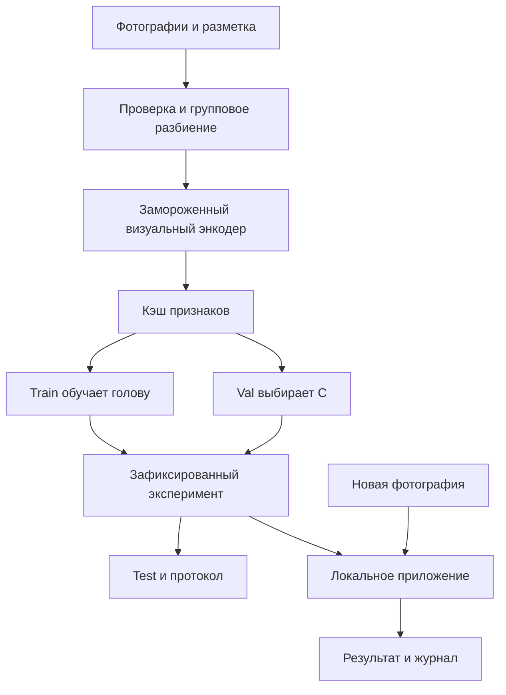

# Архитектура первой версии

## Поток данных и границы

Подготовка данных выполняется отдельно от пользовательского приложения.
CSV связывает фотографии с классами, физическими устройствами и сессиями.
После проверки и разбиения Extractor загружает локальный визуальный энкодер
один раз и создаёт кэш признаков. Обучение головы читает этот кэш, не изменяя
базовую нейросеть. В приложении Recognizer загружает энкодер и голову один раз;
вызов predict не обучает модель и не обращается к сети.

## Нейросетевая часть

MobileCLIP2-S0 — модель сопоставления изображений и текста. Здесь использованы
предобученные визуальные представления этой VLM. Генеративного декодера нет,
произвольные текстовые вопросы и описания приложение не обрабатывает.

Веса взяты из канонической адаптации timm с фиксированной ревизией, указанной
в models/base/base.json. Это та же выбранная архитектура MobileCLIP2-S0.
Из полного safetensors оставлены тензоры `visual.trunk.*`, префикс удалён.
У данной конфигурации внешняя visual-проекция отсутствует: `timm_proj=null`.
Поэтому `timm.create_model('fastvit_mci0', num_classes=512, global_pool='avg',
pretrained=False)` реализует визуальную часть без создания текстового энкодера.
Строгое совпадение ключей и размеров проверяется при подготовке базы и загрузке.

| Стадия | Контракт |
|---|---|
| Чтение | Pillow, EXIF-поворот, явное преобразование поддерживаемых режимов в RGB |
| Предобработка | Вписывание в 256×256, bilinear, чёрные поля, значения 0–1 |
| Энкодер | FastViT MCi0, FP32, eval, requires_grad=False |
| Признаки | 512 чисел, L2-нормировка по каждому изображению |
| Голова | Два линейных logit, softmax, порядок android/iphone |
| Вывод | Класс, оценка, предупреждения, версия, время обработки |

Предобработка с полями осознанно отличается от стандартного центрального crop:
важно сохранить вытянутый телефон целиком. Её влияние на качество предстоит
проверить. Нормализация mean=[0,0,0], std=[1,1,1] соответствует исходной
конфигурации MobileCLIP2-S0, а не распространённой нормализации ImageNet.

Голова обучается как бинарная LogisticRegression. Её один logit z преобразуется
в два [-z/2, z/2]; это сохраняет sigmoid-вероятности. Эквивалентность проверяется
при каждом обучении. Поэтому в итоговом файле нет исполняемых pickle-объектов.

## Модули

| Модуль | Ответственность |
|---|---|
| common.py | Версии, пути, JSON, SHA-256, стабильные отпечатки |
| images.py | Проверка изображения, EXIF, letterbox, нормализация, предупреждения |
| dataset.py | CSV, аудит, кандидаты дублей, объединение групп, разбиение |
| download.py | Единственная явная сетевая команда, проверка исходных весов |
| backbone.py | Создание и локальная загрузка энкодера, пакетные признаки |
| features.py | Кэш и проверка его соответствия текущим данным и модели |
| training.py | Fit только на train, выбор C только по val, сохранение эксперимента |
| metrics.py | Softmax и метрики классификации/уверенности |
| evaluation.py | Независимый test, CSV прогнозов и измерение ресурсов |
| inference.py | Один Recognizer на сеанс, predict, batch, журнал JSONL |
| gui.py | Tkinter, отдельный поток модели, основной поток интерфейса |
| cli.py | Команды и понятные сообщения об ошибках |

## Контракт эксперимента

База — visual.safetensors + base.json + лицензия. Голова — head.npz + run.json.
Run хранит хеш базы и головы, классы, размер входа, политику чтения, preprocessing,
порог и версии. При несовпадении база не подменяется незаметно. Runtime берёт
предобработку из run, а расположение базы из текущего config. Это позволяет
переносить проект и заменять эксперимент без изменения интерфейса.

Кэш привязан к разметке, split, содержимому файлов, базе и предобработке. Перед
train/evaluate хеши фотографий проверяются заново. Это требует доступности
исходных фотографий даже при уже готовом кэше. Хеш обнаруживает изменение,
но не подтверждает правильность ручной разметки и не является цифровой подписью.

## Что требует дальнейшей разработки

Дообучение последних блоков, сравнение с MobileNet/SigLIP, автоматическое
обнаружение телефона, калибровка уверенности и детектор посторонних объектов
не реализованы. ONNX/INT8 и облегчённый установщик также отложены до измерений
качества и ресурсов. Первое полезное продолжение — собрать данные и выполнить
зафиксированный baseline. Менять несколько компонентов до этого не стоит.
